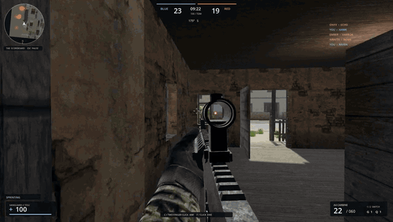
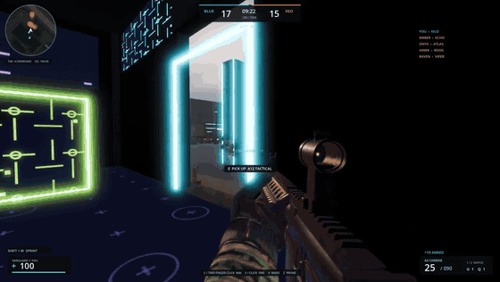

# FPS Mode

## Gameplay demo

Real-time gameplay from the full game: shooting, crouching, reloading and the kill-cam replay. The clips below play in place; click one for the full 54-second video with sound.

| Village | Neon Circuit (laser tag) |
|---|---|
| [](https://github.com/kter1/fps-mode-public/releases/download/demo-2026-10/demo_village.mp4) 
https://github.com/user-attachments/assets/f0f07a47-3fa5-4e45-8d71-db6b44162c14


| [](https://github.com/kter1/fps-mode-public/releases/download/demo-2026-10/demo_neon.mp4) | https://github.com/user-attachments/assets/6e4e4738-2914-4385-8b08-347ba77c1455


> **Note on assets in this public repository**
>
> A few assets used by the full game are not included here because their licenses
> do not allow redistribution as standalone files:
>
> - The Adobe Mixamo soldier model, team textures and animations
>   (`content/models/soldier.glb`, `content/models/characters/soldier.glb`,
>   `content/models/characters/textures/`). Mixamo permits use inside a shipped game,
>   not redistribution of the files. Download "Swat Guy" and the Rifle 8-Way Locomotion
>   and Pro Rifle packs from https://www.mixamo.com and run `tools/blender/ingest_soldier.py`.
> - The original weapon, footstep, reload, casing, click, impact and switch recordings
>   (`content/audio/{assault,lmg,marksman,shotgun,sidearm,smg,sniper,step,step_gravel,step_metal,casing,click,impact,reload,switch}_0-3.wav`),
>   whose source is not documented.
>
> Without them the project opens but soldiers and those sounds are missing. Everything
> else (code, maps, synthesized audio, CC0/CC-BY art credited in `THIRD_PARTY_NOTICES.md`
> and `content/licenses/`) is included.


A native offline first-person shooter built with Godot 4.7.2, with 1–4-player local team deathmatch and solo round-based Zombies survival. Solo play puts you on Blue alongside 7 bots against 8 Red bots; split-screen supports co-op or versus. Team deathmatch ends at 100 eliminations or ten active-play minutes.

## Play on this Mac

Open `builds/FPSMode.app`. The game embeds its models, animations, audio, maps, and lighting; normal play needs no network access or separately installed engine.

For development, run `python3 tools/dev.py run` from this directory. The pinned editor is in `.tools/godot/Godot.app`.

**Neon Circuit** is available in the team deathmatch map selector: a blacklight laser-tag arena with glowing circuit murals, cosmic carpet, overhead laser lines, a luminous reactor, ramp-accessible catwalks and detailed retro arcade machines. Launch it directly with `python3 tools/dev.py run --map neon`.

## Zombies survival

Choose **ZOMBIES / ROUND-BASED SURVIVAL** from the main menu, then **Dead Current** (power station) or **Dead Air** (quarantined airport). Start with a pistol, 500 points and two frags. Earn points from hits, kills and repairs; purchase doors to expand the map. Round transitions wait for every spawned enemy, including crawlers.

Use **E** to buy doors, chalk-outline wall guns/ammunition, box rolls and claimed offers, perks, power and traps. Hold **E** to repair boards or complete an upgrade. On a controller, hold **Square** to interact; a short tap reloads. The HUD names the exact purchase and its cost. **1/2** switches your two carried weapons; a claimed third replaces the selected slot. **G** throws a frag. A surviving zombie with exposed legs can become a crawling enemy; a fatal explosion remains fatal.

Find power to enable five perk machines and the Overcharger. Iron Heart raises health, Quick Hands speeds reloads, Long Stride raises movement speed, Second Wind grants a solo revive, and Overdrive boosts conventional weapons. Carry four perks at most. Downing consumes all perks; Second Wind restores you after three seconds. Wall ammunition costs half the base gun price, or 2,500 after upgrading; upgrading costs 5,000 once per weapon. The box costs 950, offers conventional guns plus three rare original weapons (Raycaster, Thunder Cannon and Arc Rifle), and can relocate after repeated use. Claim its offer before it closes. Drops provide Max Ammo, Double Points, Insta-kill, Nuke or Carpenter. Each map includes a powered electric trap that also hurts the player.

Zombies has its own HUD, results and per-map records. Escape pauses simulation. Restarting resets points, doors, power, perks, boards and enemies. TDM retains its separate maps, loadouts and respawn rules. The textured zombie and authored animations are by [Pixelhouse](https://opengameart.org/content/zombie), licensed CC BY 3.0; FPS Mode adapts its materials, scale, severed mesh and crawler animation. Artist attribution is available through ART CREDITS in the main menu and in `content/licenses/pixelhouse_zombie.txt`. Ruin dressing, machines and synthesized Zombies cues are original; existing props retain their provenance manifests.

Development commands:

```sh
python3 tools/dev.py run --mode zombies --map dead_current
python3 tools/dev.py test --suite zombies
python3 tools/dev.py zombies-probe
python3 tools/dev.py inspect-zombies
python3 tools/dev.py zombies-smoke --map dead_current --seed 2601
python3 tools/dev.py capture --mode zombies --map dead_air --seed 2602
python3 tools/dev.py match-test --mode zombies --map dead_current --seed 2601
python3 tools/dev.py benchmark --mode zombies --map dead_current --seed 2601 --seconds 600
python3 tools/dev.py smoke-export --mode zombies --map dead_current --seed 2601
```

See `ZOMBIES_VISUAL_UPGRADE.md` for the reference-driven character/environment revision and `ZOMBIES_VALIDATION.md` for measured evidence and remaining limits. The scripted round scenario uses a protected QA player, perk/upgraded-weapon loadout and replenished magazine/reserve; it is not a human difficulty or fun assessment.

## Local split-screen (2–4 players)

Open **Deploy / Team Deathmatch**, choose **2, 3, or 4 local players**, then start the match. The default uses keyboard and mouse for Player 1 and one controller for each additional player; select **All players use controllers** for up to four controllers. Each player gets their own camera, health/ammo display, kills/deaths, and respawn. Choose **Co-op** to put all local players on Blue against bots, or **Versus** to alternate players between Blue and Red. Bots fill both teams to eight players.

Two players share a horizontal split; three and four use a four-panel grid. Controllers are assigned in connection order. A disconnected controller releases its inputs and leaves its seat waiting; reconnecting a controller fills the first waiting seat. Options/Start pauses the whole match. Tap Circle to crouch and hold Circle for 350 ms to toggle prone. The selected loadout is copied to each player at the start.

Split-screen is available in Team Deathmatch. Campaign and Zombies keep their existing single-player setup. Rendering several views increases GPU load; no four-player frame-rate target is guaranteed.

Verification: `python3 tools/dev.py test --suite local-multiplayer`. The rendered probe is `tools/local_multiplayer_probe.gd` and saves screenshots/reports under `.artifacts/`.

## Controls

| Action | Default |
|---|---|
| Move / look | WASD / mouse |
| Fire | Hold F or left click (press per shot for semi-auto) |
| Aim | Tap C or two-finger secondary click to toggle; Settings also offers hold aim |
| Sprint / crouch | Hold Shift / Ctrl |
| Prone | Tap Z or hold Circle on a controller; repeat to stand (tap Circle to crouch) |
| Jump / reload | Space / R |
| Primary / sidearm | 1 / 2, or mouse wheel |
| Frag / smoke | G / Q |
| Knife | V (R3 on a controller) |
| Pick up a dropped weapon | E (hold Square on a controller) |
| Skip kill replay / final kill cam | Space, F, left click, or Enter (Cross on a controller) |
| Scoreboard / pause | Hold Tab / Escape |

On a laptop, use one finger to look, tap C to aim, and hold F to shoot. Shift + W sprints; the HUD confirms SPRINTING. Two-finger secondary click also toggles aim when enabled in macOS. No simultaneous trackpad clicks are required.

Keyboard bindings, mouse sensitivity, vertical FOV, sound volume, and visual quality can be changed in Settings. Escape releases the mouse and pauses the match. Losing focus also pauses normal play.

Combat audio includes spatial gunfire from the whole roster, surface footsteps, equipment rustle, jumps and landings, nearby bullet snaps and ricochets, material impacts, grenade handling and bounces, smoke hiss, and hit/kill feedback. Quiet wind, machinery or birds suit each battlefield; low health adds a subtle heartbeat. Gunfire has its own bounded voice pools so small effects cannot interrupt it. All added sounds are synthesized offline with `python3 tools/synthesize_world_audio.py`; the original gun recordings are preserved. Run `python3 tools/dev.py test --suite audio` for audio regressions.

## Maps and equipment

Nine TDM battlefields are registered in `content/manifest/map_list/`. Pick one before a local match: **Deploy → Battlefield** on the Operations screen lists them in registry order (Airport, Foundry, Ridgeline, Harbor, Village, Blackout Station, Neon Circuit, Transit Works, Glacier Peak). Airport is the default and appears behind the main menu. Each map's layout, lighting and overview labels are described in `MAP_DESIGN.md`.

- **Airport:** 112 × 88 m regional airport with a glazed terminal, check-in and security screening, gate lounges, baggage claim, maintenance hangar, and a boardable passenger jet. Three boarding ramps connect the cabin to an open apron loop. Broad terminal openings, an open sorting shelter and a covered shuttle stop make the routes easy to read; buses and airport equipment provide local cover. The runway and control tower extend beyond the playable perimeter. Use `--map airport` for development commands.
- **Foundry:** 110 × 90 m modern assembly facility, dispatch and power rooms, freight lanes and an elevated maintenance walkway. The playable area is 75% smaller than the previous map.
- **Ridgeline:** 120 × 96 m modern communications campus, glazed operations buildings, paved courtyard, logistics wing and elevated walkway. The playable area is 76% smaller than the previous map.
- **Harbor:** 110 × 90 m container terminal at berth 3, overcast late afternoon. Warehouse 7 with a steel mezzanine, a yard of stacked containers, and a quay under two cranes with open water beyond.
- **Village:** 110 × 90 m overgrown farming village in summer. A cobbled main street crosses a church square, with two-storey houses, an orchard, back gardens and wooded hills beyond.
- **Blackout Station:** 110 × 90 m coastal power station at dusk during a grid failure. Fight through the transformer switchyard, the brick turbine hall with its raised control deck, or the pump house and fuel tanks beside the seawall. Generator-fed floodlights and amber emergency lamps illuminate the site. Use `--map blackout` for development commands.
- **Glacier Peak:** 112 × 100 m fractured glacier basin with a physical blue-ice river, northern snow shelf, suspension crossing, open crevasse run, and three scattered expedition refuges. Use `python3 tools/dev.py run --map glacier_peak`.
- Fifteen firearms cover assault rifles, SMGs, shotguns, LMGs, a marksman rifle, a bolt-action rifle, and sidearms. Their statistics are fictional gameplay values.
- Five editable presets save locally. Attachments change optics, recoil, capacity, reloads, aim time, spread, or gunfire audibility. Choose up to three compatible attachments per weapon. Optics include bare iron sights, a red dot, a holographic circle/dot sight, and a 3× scope; the sniper includes a standard 6× optic.
- Eight supply caches on each map restore reserve ammunition. Fallen soldiers drop their weapon with the rounds left in it: walk over it for ammunition (all of its rounds into the same gun, one magazine for each other gun, once per weapon) or press E to swap for it. Dropped weapons lie for 30 seconds, ten at most.
- The knife is a one-strike kill on the nearest enemy within 2.4 m in front of you; bots use it face to face too.
- Health regenerates after six seconds without damage; red at the screen edges closes in as health falls and pulses on each hit, with a wedge pointing at the shooter. Death schedules one three-second respawn.

## Build and verification

Requires Python 3, curl, and macOS. Dependencies stay in this checkout. Initial setup needs network access for official Godot binaries and CC0 art.

```sh
python3 tools/dev.py setup
python3 tools/dev.py prepare
python3 tools/dev.py check
python3 tools/dev.py test --suite core
python3 tools/dev.py test --suite audio
python3 tools/dev.py audio-check
python3 tools/dev.py test --suite integration
python3 tools/dev.py graphics-check
python3 tools/dev.py render-cleanup --map foundry
python3 tools/dev.py render-cleanup --map ridgeline
python3 tools/dev.py render-cleanup --map harbor
python3 tools/dev.py render-cleanup --map village
python3 tools/dev.py capture --map foundry
python3 tools/dev.py capture --map ridgeline
python3 tools/dev.py capture --map harbor
python3 tools/dev.py capture --map village
python3 tools/dev.py inspect-map --map foundry
python3 tools/dev.py inspect-map --map ridgeline
python3 tools/dev.py inspect-map --map harbor
python3 tools/dev.py inspect-map --map village
python3 tools/dev.py benchmark --map foundry --seed 1201 --seconds 600
python3 tools/dev.py benchmark --map ridgeline --seed 1202 --seconds 600
python3 tools/dev.py benchmark --map harbor --seed 1203 --seconds 600
python3 tools/dev.py benchmark --map village --seed 1204 --seconds 600
python3 tools/dev.py benchmark --map foundry --seed 1201 --seconds 60 --stress
python3 tools/dev.py benchmark --map ridgeline --seed 1202 --seconds 60 --stress
python3 tools/dev.py benchmark --map harbor --seed 1203 --seconds 60 --stress
python3 tools/dev.py benchmark --map village --seed 1204 --seconds 60 --stress
python3 tools/dev.py export
python3 tools/dev.py smoke-export
```

On macOS, `check` and `prepare` use the native Metal editor for asset importing (including layered lightmap shadow textures and 3D texture detection). Import runs in recovery mode, with tool scripts and editor plugins disabled; the later lighting bake enables its editor plugin normally. Gameplay tests still run headlessly.

`prepare` generates saved scenes and navigation, then uses a small project editor plugin to invoke Godot's lightmap baker. That plugin only acts when explicitly launched with `--bake-maps` (every registered map) or `--bake-scene=<path>`. `prepare --map <id>` prepares and bakes one map; without `--map` it does all of them. Per-map commands accept any id registered in `content/manifest/map_list/` (default: the first one); see "Adding a map" in `MAP_DESIGN.md`.

All renders, bakes and benchmarks go through `dev.py` so they queue. Every rendered Godot run (editor imports, lightmap bakes, captures, benchmarks, cleanup and inspection runs, `run`, the exported smoke test) and every Blender invocation first takes an exclusive `flock` on `.tools/render.lock`, resolved through the `.tools` symlink so the main checkout and every worktree share the same file. A second checkout prints `waiting for render lock` once and blocks until the first finishes; headless tests and prepare steps do not take the lock. Do not launch Godot or Blender directly for rendering work while another session may be measuring.

Tests use `.artifacts/test-profile`; QA runs use separate profiles. Headless runs omit presentation meshes and sound while retaining the same collision, movement, AI, combat, and scoring. Rendered cleanup scenarios additionally exercise live effects and three consecutive matches on each map. Normal saves use Godot's application user-data directory. Test reports, raw frame intervals, screenshots, and engine logs go in `.artifacts`. Rendered benchmarks use a fixed internal 1920×1080 world target at Medium, 30 seconds of warm-up, normal simulation speed, and all 16 roster slots. Headless tests do not establish rendering performance.

## Source structure

`game/core` owns application/match flow and saves. `game/actors` contains shared movement and controller commands. `game/combat` owns weapon state and damage. `game/maps` contains deterministic map construction and saved scenes. Presentation and UI remain separate. Weapon/attachment resources live in `content/data`.

The complete application is offline.

The presentation aims for grounded realism:

- **First person:** tactical gloves and combat-shirt sleeves (no exposed skin) on a skinned arm rig whose hands are solved onto each weapon's grip and support points every frame. Recoil, sway, breathing and sprint carry are spring-driven; reloads move the weapon's real magazine with the support hand.
- **Weapons:** fifteen real-scale CC0 firearms with authored PBR materials, separate magazines, bolts and pumps, and modelled red-dot, holographic, 3× scope, suppressor, compensator and grip attachments. Reflex reticles glow on the lens.
- **Soldiers:** a motion-captured Mixamo soldier with team-specific woodland and desert camouflage, an 8-way locomotion blend tree, aim-following spine, both hands on the weapon, and ragdoll deaths.
- **Maps:** photoscanned surfaces, HDRI skies, fixed exposure, directional baked lighting with probes, lit interiors, props, decals and landscape beyond the boundaries (see `MAP_DESIGN.md`).
- **Effects:** moving tracers, per-surface impacts with bullet-hole decals, animated muzzle flashes, modelled brass and particle smoke.

This is a realism improvement within Godot on an M2 Mac, not AAA photorealism. See `COMBAT_ART.md` and `MAP_DESIGN.md` for the asset pipelines.

Gameplay uses Forward+ through native Metal on this Mac. Low, Medium, and High use fixed internal render targets; the interface stays at presentation resolution. All three presets combine 4× multisampling with temporal antialiasing in the shared world viewport. Textures use 16× anisotropic filtering, ground UVs remain fixed during camera movement, and visibility uses frustum culling rather than the authored occluder volumes. The first-person rig renders in the world pass with its own 70° field of view and depth range, so it shares the scene's lighting and never clips through walls. Scoped aiming magnifies the world camera and hides the rig behind the scope eyepiece.

The first-person presentation keeps one skinned arm rig and a bounded cache of 24 weapon configurations across switches, respawns and replay viewpoints. Cosmetic particles use bounded CPU pools to avoid the pinned engine's native GPU-particle shader leak during teardown.

See `VALIDATION.md` for actual verification results and remaining limits. Domination and hardpoint have map anchors prepared for future implementation. Online multiplayer and other platform builds are future work.

## Credits

- **Soldier and animations:** "Swat Guy" and the Rifle 8-Way Locomotion / Pro Rifle packs from **Adobe Mixamo**, used under Mixamo's terms (royalty-free in games; the raw files are not redistributed and stay in the git-ignored `.tools/`). Processed output and clip mappings: `content/manifest/characters.json`.
- **Firearms:** the Free CC0 Guns & Explosives Pack by **3DModelsCC0** (CC0), plus Poly Haven's bolt-action rifle and service pistol by **Mateusz Sadek** (CC0). Slot mappings and sockets: `content/manifest/weapons.json`.
- **First-person arms:** rig based on **para**'s CC0 FPS arms (MakeHuman), re-dressed as gloves and sleeves using Poly Haven fabric and leather scans.
- **Environment:** CC0 photoscanned materials, props and HDRI skies from **Poly Haven** and **ambientCG**; each asset's authors are listed in `content/manifest/maps.json`, the per-map manifests in `content/manifest/maps/`, and `content/licenses/`.
- Earlier Quaternius and Tabasco assets remain recorded in `content/asset_manifest.json` and `content/licenses`; the current game no longer displays them.

Map layouts and architecture, UI, gameplay code and synthesized audio are original to this project. Godot is distributed under the MIT license; see `THIRD_PARTY_NOTICES.md`.

Additional inspection tools: `inspect-arsenal` captures hip and aimed views for all fifteen weapons; `inspect-operators` captures five combat poses; `inspect-map --map <id>` captures a labelled layout overview of any registered map; `inspect-optics` captures actual ADS views for the four optic choices; `clip --map foundry --seconds 45` records an AVI gameplay sample. Movie recording uses fixed simulation steps and is not a rendering benchmark. `python3 tools/release_verify.py` runs the complete sequential verification suite, and `python3 tools/report.py` assembles the evidence.

Death shows a short reconstruction of the killer’s recorded first-person viewpoint. Space or F skips it; the three-second respawn timer continues. The match ends on a final kill cam: the last kill of the match from the killer's eyes, slowing into the shot, before the results. Sixteen spawn points per team span four deployment clusters. Safe, unoccupied points are preferred, with recent-use and previous-spawn penalties to vary redeployments. A clear exposed point receives spawn protection when no hidden point is available at the deadline.

## Concurrent development and original snapshot

The original source snapshot is commit `117d045ac069c9017f865622da627364c6309df4` (`Baseline snapshot of FPS Mode project`). Inspect it with `git show` or a separate worktree; resetting the active checkout would discard subsequent work.

The current roster is **8 per team, 16 total**, with one human in Blue slot 0, Blue bots in slots 1–7 and Red bots in slots 8–15. Regression checks explicitly pin these values, the 100-kill limit and the 600-second timer.

## Campaign: Dead Circuit

Choose **CAMPAIGN / DEAD CIRCUIT** from the main menu. This first mission reuses
Blackout Station with two AI squadmates, four finite encounters, objective markers,
radio text, and an extraction ending. Clear the active enemies and stay within
four metres of the objective for three continuous seconds to advance. Leaving
the zone resets the hold. The objectives lead through the pump house, switchyard,
raised control deck, and seawall extraction.

Each completed objective saves a checkpoint in the local profile. Death ends the
attempt; **Retry checkpoint** rebuilds the current encounter with fresh loadout
ammunition. **Continue** in the campaign briefing resumes saved progress after
quitting. Beginning or completing the mission resets saved progress. The armory's
selected loadout and briefing difficulty apply on deployment. This is an initial
playable mission: the power objective does not rebake or change map lighting,
and extraction ends at the results screen. Duration and difficulty have
not yet been established by human playtesting. The local `builds/FPSMode.app` bundle includes this mission.

```sh
python3 tools/dev.py run --mode campaign --map blackout
python3 tools/dev.py test --suite campaign
```

### Campaign voices

Dead Circuit opens with three-character voice dialogue: Rook and
Atlas speak from their squad positions; Control plays through a filtered radio.
Speaker-labelled subtitles follow the actual clip durations. Atlas's relay line
uses the approved alternate take. Dialogue begins after the deployment countdown
while normal gameplay continues. Pausing pauses dialogue; death, leaving the
mission, a squad speaker dying, or advancing to a new encounter cancels it.
Retrying the opening checkpoint plays a fresh introduction; later checkpoints
skip arrival dialogue. Later objectives retain their text briefings.

The ten individual clean recordings are bundled under
`content/audio/campaign/dead_circuit/`; no extra ambience is layered over the
map's existing audio. The voices are synthesized and need no network connection at runtime. Approved take hashes are in `content/data/campaign/dead_circuit_dialogue.json`
and `content/licenses/dead_circuit_voices.txt`. This integration adds voice and
subtitles; it does not add lip sync or character choreography.
